<div align="center">

# 端侧 AI 电脑操作助手

**像人一样看屏幕、动键鼠的 Windows 桌面 Agent：自动回复微信和 QQ 邮箱，不依赖软件接口，模型和数据都留在内网。**


[项目简介](#项目简介) · [工作原理](#工作原理) · [快速开始](#快速开始) · [验收结果](#验收结果) · [路线图](#路线图) · [文档](#文档)

</div>

---

## 项目简介

办公时每天要在微信和邮箱里处理大量消息，很多回复都有固定答法，却仍要人一条条打开、阅读、回复。现有方案各有短板：微信机器人依赖协议或 hook，有封号风险，微信一升级就失效；RPA 要为每个软件写死流程，读不懂微信 4.x 这类自绘界面；云端的电脑操作 Agent 又要把聊天截图传到外网。

本项目让 AI 直接"看"屏幕、"动"键鼠：

- **不依赖软件接口**：不用协议、不注入进程，界面怎么显示就怎么读、怎么点。
- **感知分流**：读得到界面结构的软件（Chrome 里的 QQ 邮箱）直接读 Windows 无障碍控件树；读不到的（微信 4.x）用截图 + OCR + 视觉定位。两条路交回同一种格式，主循环不用区分。
- **数据不出内网**：模型部署在公司内网的 DGX Spark 上，电脑端只负责截图、读界面和执行键鼠。
- **安全由程序把关**：发给谁、发什么、点哪里，都先过程序规则；模型说"完成"不算数，由程序重新截图独立核对。

第一版范围：Windows；微信测试号的单聊文字消息；Chrome 网页版 QQ 邮箱。

## 工作原理

主循环是一张 [LangGraph](https://github.com/langchain-ai/langgraph) 状态图，每一圈只做一个动作，核对没通过就回到「看」重来：

<p align="center"></p>

| 节点 | 做什么 | 实现 |
|---|---|---|
| 看 `look` | 截取窗口画面（被其他窗口挡住也能截），读出每段文字和位置 | 窗口截图 + [RapidOCR](https://github.com/RapidAI/RapidOCR)（本机 CPU） |
| 想 `think` | 把截图、任务和已走过的步骤交给模型，决定下一步：点击、输入、回车、完成或放弃 | Qwen3.8-27B |
| 定位 `locate` | 把"点哪个元素"变成坐标，再用 OCR 把点校正到文字中心 | [UI-TARS-1.5-7B](https://github.com/bytedance/UI-TARS) + OCR |
| 规矩 `rules` | 程序判断这一步能不能做，不问模型；被拦的原因交给模型下一圈参考 | 纯规则，见[安全设计](#安全设计) |
| 做 `act` | 模拟键鼠：点击、剪贴板粘贴（先清空输入框）、回车 | Win32 输入 |
| 核对 `check` | 重新截图：回车后数聊天区里这条消息是否多了一条；其他步骤看画面有没有按预期变化 | 程序判断 |

步数和失败次数都有上限，防止卡住时无限重试。

## 快速开始

### 环境要求

- Windows 10 / 11，Python 3.12
- 两个 OpenAI 兼容接口的模型服务：一个多模态大模型负责规划，一个 UI-TARS 负责定位
- 微信 4.x 桌面版；QQ 邮箱用 Chrome 打开

### 安装

```bash
git clone https://github.com/kukugil/edge-agent-box.git
```

```bash
cd edge-agent-box
```

```bash
python -m pip install -r requirements.txt
```

### 配置

**1. 模型地址**：`agent/config.json`。仓库里填的是内网 Spark 的地址，在别的网络里要换成自己的服务。

| 键 | 含义 |
|---|---|
| `vlm_url` / `vlm_model` | 规划用的多模态大模型 |
| `grounder_url` / `grounder_model` | 定位用的 UI-TARS |
| `grounder_max_pixels` | 送给 UI-TARS 的图片像素上限 |

**2. 白名单**：新建 `agent/test_contacts.local.json`。程序只会给名单里的会话和邮箱发消息；这个文件不进版本库，每人写自己的测试联系人。

```json
{
  "说明": "只放测试用的联系人",
  "allowed_chats": ["测试好友A", "测试好友B"],
  "allowed_mail": ["你的测试邮箱@qq.com"]
}
```

**3. Chrome（只有邮件需要）**：带无障碍参数启动，网页内容才读得到；用单独的配置目录，不影响日常使用的浏览器。

```powershell
& "C:\Program Files\Google\Chrome\Application\chrome.exe" --user-data-dir="$PWD\.chrome-agent" --force-renderer-accessibility --disable-features=CalculateNativeWinOcclusion --disable-backgrounding-occluded-windows https://mail.qq.com
```

### 运行

离线测试核对逻辑（不动键鼠）：

```bash
python -m agent.core.check
```

给白名单里的好友发一条微信：

```bash
python -m agent.core.graph 测试好友A "测试 1"
```

> [!WARNING]
> 第二条命令会真实操作鼠标键盘。运行前先把微信主窗口打开（不要最小化），运行期间不要碰鼠标键盘。

## 验收结果

MVP 验收（微信 2026-11-04，邮件 2026-11-06）：

| 场景 | 通过线 | 结果 |
|---|---|---|
| 微信：回复指定会话 10 轮 | ≥ 8 轮成功，误发 = 0 | ✅ 程序判定 8/10，实际发出 10/10，误发 0 |
| QQ 邮箱：回复 10 封测试邮件 | ≥ 9 封成功，收件人错误 = 0 | ✅ 10/10，收件人错误 0 |

完整记录、调试中修过的问题和已知局限见 [D8 验收记录](docs/D8-acceptance.md)。

## 安全设计

所有规则都由程序执行，不依赖模型自觉：

- **只发白名单**：收件人不在名单里，一步都不做，直接结束。
- **先认人再发**：当前会话标题和目标一致，才允许输入和回车。
- **逐字一致**：输入的文字必须正好是任务要发的那句，模型不能自己改写。
- **限制按键和点击**：只许按回车（Esc 会把微信藏进托盘）；不点关闭、最小化、标题栏和网页搜索建议。
- **先查窗口能不能响应**：动键鼠之前确认窗口能正常响应。
- **独立核对**：模型说"完成"不算数，程序重新截图，确认消息真的多了一条。
- **不留聊天记录**：微信截图不保存，日志只打印动作种类，不打印聊天内容。

## 路线图

- [x] 可行性实验，手写版主循环
- [x] 工具层：截图、OCR、定位、键鼠、窗口、读控件树
- [x] LangGraph 主循环，微信 10 轮验收
- [x] 感知分流接入 QQ 邮箱，完成 MVP 验收
- [ ] 新消息触发和会话排队
- [ ] 应用配置文件，异常恢复（弹窗、窗口被挡、中途来新消息）
- [ ] 联系人记忆和回复生成，不会答的转人工
- [ ] 护栏：人机切换，一键急停
- [ ] 技能固化：跑通的流程直接回放，不再每步问模型
- [ ] 一句话任务入口
- [ ] 一键评测，长时间稳定运行


## 项目结构

```text
edge-agent-box/
├── agent/
│   ├── core/            主循环：状态、图、微信和邮件的核对规则
│   ├── tools/           工具层：截图、OCR、定位、键鼠、窗口、读控件树
│   ├── demos/           各工具的演示、手写版基线、测试数据脚本
│   ├── practice/        学习练习
│   └── config.json      模型服务地址
├── docs/                验收记录、主循环图
├── experiments/         早期可行性实验脚本
├── AGENTS.md            AI 编程助手的协作规则
└── requirements.txt
```

## 文档

| 文档 | 内容 |
|---|---|
| [D8 验收记录](docs/D8-acceptance.md) | MVP 验收结果和已知局限 |
| [AGENTS.md](AGENTS.md) | 分工、代码约定和安全硬规则 |

## 致谢

[LangGraph](https://github.com/langchain-ai/langgraph) · [RapidOCR](https://github.com/RapidAI/RapidOCR) · [UI-TARS](https://github.com/bytedance/UI-TARS) · [Qwen](https://github.com/QwenLM) · [Python-UIAutomation-for-Windows](https://github.com/yinkaisheng/Python-UIAutomation-for-Windows)

## 免责声明

本项目用于研究和内部演示，只在测试账号上运行。用自动化工具操作微信等第三方软件，可能违反其用户协议并导致账号受限，使用者需自行承担风险。

## 许可证

暂未选择开源许可证。在添加许可证之前，代码版权归作者所有，未经许可不得复制、修改或再分发。
